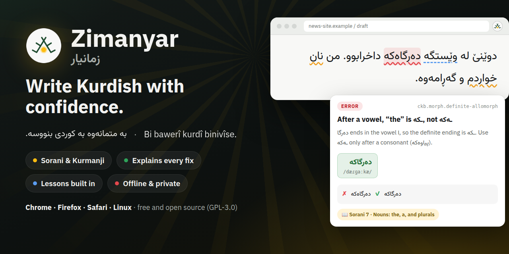
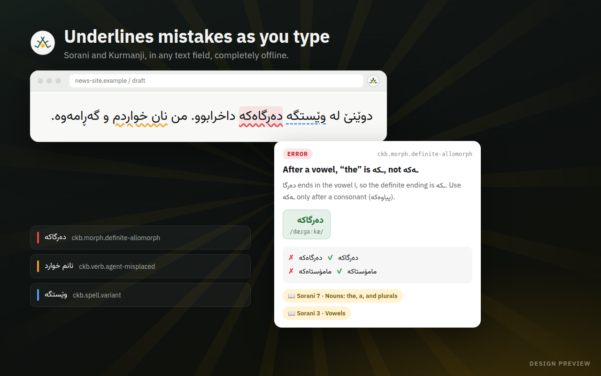
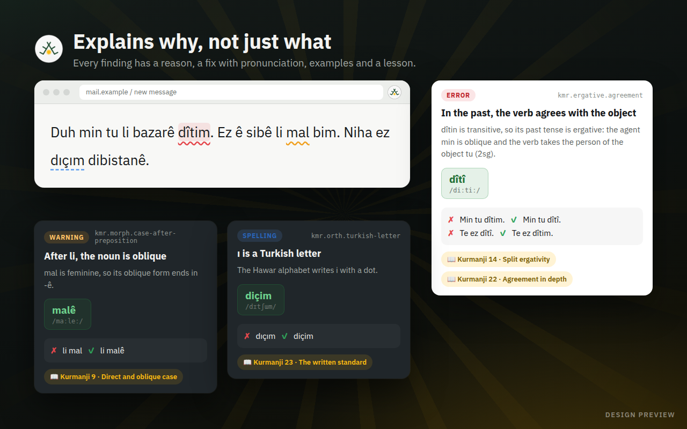
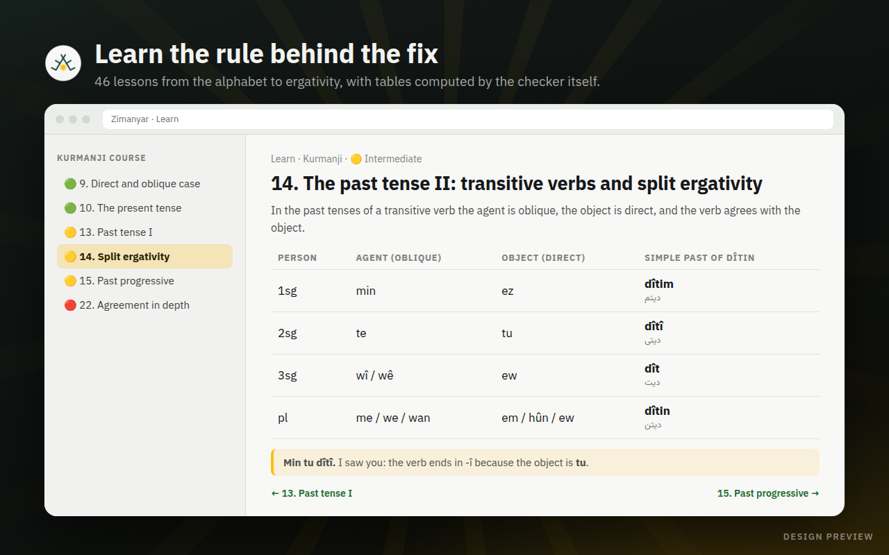
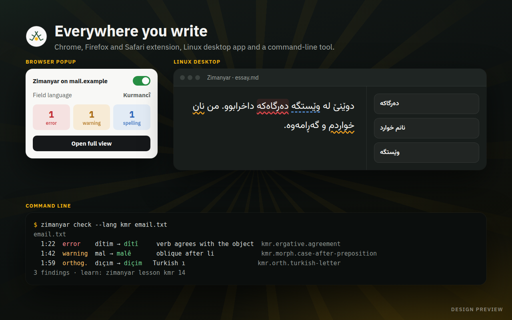

<div align="center">
  

# Zimanyar

**The offline grammar checker and teacher for Kurdish.**

زمانیار · Zimanyar · *language helper* in Kurdish

[](#status)
[](#what-it-checks)
[](#private-by-design)
[](https://github.com/0xdolan/zimankit)
[](LICENSE)

[What it checks](#what-it-checks) · [Surfaces](#where-it-runs) · [How it works](#how-it-works) · [The name and the logo](docs/STORY.md) · [Brand](assets/brand/README.md) · [zimankit](https://github.com/0xdolan/zimankit)


</div>

Zimanyar finds mistakes in **Sorani** (`ckb`) and **Kurmanji** (`kmr`), explains why they are wrong, fixes them in one click, and teaches the grammar behind every fix. It understands what makes Kurdish Kurdish: the ezafe, definite endings, personal clitics, and the split ergativity that makes the past tense work differently from the present. Everything runs on your device: no account, no cloud, no tracking.

The name joins *ziman*, language, and *yar*, friend and helper; the logo joins the crown of *deq*, the traditional Kurdish tattoo, with Roj, the sun of the flag of Kurdistan. [Read the story and its sources](docs/STORY.md).

## Status

Zimanyar is **in design** and is being built on the `develop` branch. The images in this README are design previews of the planned interface, rendered from HTML templates; every Kurdish example and every finding in them is a real rule. There are no releases yet.

## Features

- **Checks as you type.** Spelling, orthography, morphology and agreement mistakes are underlined in any text field: web pages, the popup, the desktop app or a terminal.
- **Explains why, not just what.** Every finding says what is wrong and why, gives the correct form with its pronunciation in IPA, and shows wrong and right examples.
- **Teaches the rule.** Every finding links to the lesson that teaches it: 46 lessons, 23 for each variety, from the alphabet to ergativity.
- **Fixes legacy text.** Arabic and Persian letters typed for Kurdish ones (ك ي ة, ه for ە), missing marks (ڕ ڵ ێ ۆ), and Turkish letters in Kurmanji (ı İ ğ) are found and fixed, safely and in bulk.
- **Autocomplete that knows Kurdish.** Suggestions come from an 830 000-form lexicon with full verb paradigms, ranked by frequency, with helpers for ê î û ş ç.
- **Knows what is not Sorani or Kurmanji.** Zazaki, Gorani, Persian, Arabic, Turkish and English text is recognised and left alone.
- **Three interface languages.** English, کوردی سۆرانی and Kurmancî, with full right-to-left layout.
- **Private by design.** No text ever leaves your device. The checker makes no network requests, and a test fails the build if it ever does.

## A look at Zimanyar

| Underlines mistakes as you type · Sorani | Explains why, not just what · Kurmanji |
| --- | --- |
|  |  |

| Learn the rule behind the fix | Everywhere you write |
| --- | --- |
|  |  |

## What it checks

A few rules from the catalogue:

| Variety | Mistake | Correction | Why |
| --- | --- | --- | --- |
| Sorani | دەرگاەکە | **دەرگاکە** | after a vowel, "the" is ـکە |
| Sorani | من نان خواردم | **من نانم خوارد** | in the past, the agent clitic goes on the object |
| Sorani | وێستگه | **وێستگە** | legacy encoding: ه used for the vowel ە |
| Kurmanji | Min tu dîtim. | **Min tu dîtî.** | in the past, a transitive verb agrees with the object |
| Kurmanji | li mal | **li malê** | the noun after a preposition is oblique |
| Kurmanji | dıçım | **diçim** | ı is a Turkish letter |

Every rule has an explanation, at least two wrong and right examples and a lesson link, and is measured for precision and recall on a hand-annotated corpus of real mistakes, so Zimanyar does not drown you in false alarms. A **Tolerant** mode accepts common colloquial forms for writers who do not want the written standard enforced.

## Where it runs

All surfaces share one engine, one rule set and one interface.

| Surface | What you get | Channel |
| --- | --- | --- |
| Chrome, Edge, Brave | in-page checking, popup, settings, side panel | Chrome Web Store |
| Firefox | in-page checking, popup, settings, sidebar | Firefox Add-ons |
| Safari | the same extension | Xcode project in the GitHub releases |
| Linux desktop | editor, lessons, tools; a global shortcut checks the clipboard | `.deb`, `.rpm`, AppImage; Flatpak later |
| Command line | `zimanyar check`, with text, JSON and SARIF output for CI | npm and `.deb` |
| Editors | diagnostics, quick fixes, hovers and completion over LSP | `zimanyar-lsp` |
| Web | a live checker, the lessons and the rule catalogue | <https://0xdolan.github.io/Zimanyar/> |

The extension asks for the fewest permissions it can: it runs only on the sites you turn it on for, and never loads remote code.

## How it works

Zimanyar is a TypeScript port of [zimankit](https://github.com/0xdolan/zimankit), the Kurdish linguistic toolkit: normalisation, tokenisation, language identification, IPA, transliteration, morphology, verb paradigms and the split-ergativity checker. Tens of thousands of input and output pairs exported from zimankit are replayed against the port in CI, and any difference fails the build.

```
@zimanyar/data       lexicon automata and rule data, built from the zimankit bundle
@zimanyar/core       the port of zimankit: normalise, tokenise, identify, phonology, morphology, verbs
@zimanyar/rules      rule implementations, explanations, examples and lesson links
@zimanyar/checker    document model, rule runner, incremental cache, worker entry
apps/                web (Astro), extension (WXT), desktop (Tauri), cli, lsp
```

The checker runs in a worker, so typing never waits for it. Only changed paragraphs are checked again, and each language's lexicon is loaded once, on first use, and kept on the device.

### Private by design

There is no server. The extension, the desktop app and the command line make no network requests while checking, which is tested on every build. There is no account, no telemetry and no sync: your personal dictionary and settings stay on your device, and you can export or delete them at any time.

## The zimanyar command

Planned for the first release:

```sh
zimanyar check notes.ku.md                    # findings, with explanations
zimanyar check --lang kmr --format json -     # read stdin, write JSON
zimanyar check --fix --rules orthography *.md # apply the safe fixes
zimanyar explain ckb.morph.definite-allomorph # the rule, with examples and lessons
zimanyar conjugate xwendin                    # a full verb paradigm
zimanyar ipa "بە متمانەوە بە کوردی بنووسە"
zimanyar translit "Bi bawerî kurdî binivîse."
```

`zimanyar check` exits with 0 when the text is clean, 1 when there are findings at or above `--fail-on`, and 2 on a usage error, so it fits into CI.

## Learn Kurdish

The lessons Zimanyar links to come from zimankit's two complete courses, each with 23 lessons from beginner to advanced:

- [Central Kurdish (Sorani) course](https://github.com/0xdolan/zimankit/tree/main/docs/tutorials/ckb)
- [Northern Kurdish (Kurmanji) course](https://github.com/0xdolan/zimankit/tree/main/docs/tutorials/kmr)

## Development

```sh
make logo            # the logo SVG variants, from scripts/brand/make-logo.mjs
make icons           # every icon size for the extension, the web and Linux (Inkscape, ImageMagick)
make marketing       # banner, store tiles, store screenshots and ads (headless Chrome)
make check-dashes    # fail on em dashes, en dashes and look-alikes
```

| Path | What it holds |
| --- | --- |
| `assets/brand/` | The logo masters, wordmarks and [brand guide](assets/brand/README.md) |
| `assets/icons/` | Rendered icons: PNG sizes, extension, web and PWA, the Linux hicolor tree |
| `assets/marketing/` | Banner, social preview, store tiles and screenshots, ads in English, Sorani and Kurmanji |
| `scripts/brand/` | The logo geometry and the icon renderer |
| `scripts/marketing/` | HTML templates and the content of every marketing image |
| `docs/` | [The name and the logo](docs/STORY.md) |

The engine, the apps and the website arrive phase by phase. Contributors, human or tooling, follow the rules in [CLAUDE.md](CLAUDE.md): no AI or bot attribution, no em or en dashes, and every interface string translated into English, Sorani and Kurmanji.

## Branches and releases

Zimanyar follows git flow. Work happens on `feature/NAME` branches from `develop`, merged by pull request into `develop`. A release goes from `develop` to `main` on a `release/X.Y.Z` branch, also by pull request; `main` is what is released. Versions follow [Semantic Versioning](https://semver.org/), and every release has a tag and a changelog entry.

## Credits

- Linguistic engine and lessons: [zimankit](https://github.com/0xdolan/zimankit).
- Sibling project: [Roj](https://github.com/0xdolan/roj), the Kurdish solar calendar.
- Roj emblem: [Wikimedia Commons](https://commons.wikimedia.org/wiki/File:Roj_emblem.svg), public domain. Story sources: [docs/STORY.md](docs/STORY.md).
- Fonts under the SIL Open Font License 1.1: [IBM Plex Sans](https://github.com/IBM/plex), [Vazirmatn](https://github.com/rastikerdar/vazirmatn).

## License

Code: [GPL-3.0-or-later](LICENSE) © 0xdolan. Bundled lexical data: CC BY-SA 4.0.

<p align="center"></p>
