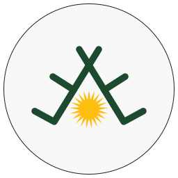
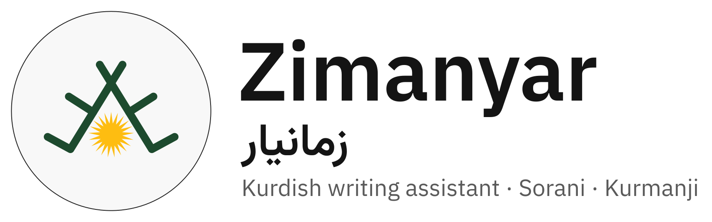

# Zimanyar brand

 

## Concept

**The Kurdish sun under the crown.** The logo joins two Kurdish signs: the **crown** (تاج, *taj*) of *deq*, the traditional Kurdish tattoo, which stands for leadership and truthfulness, and **Roj**, the 21-ray sun of the flag of Kurdistan, which shines where the sign has its dot. The crown's left foot and long stroke form a check mark: correct, truthful Kurdish. The story and its sources are in [docs/STORY.md](../../docs/STORY.md).

The logo is a sibling of the [Roj](https://github.com/0xdolan/roj) logo, which also joins a deq sign with the sun of the flag, and shares its white disc with a thin rim.

## Colours

| name | hex | use |
|---|---|---|
| paper | `#F8F8F8` | disc |
| rim | `#1E1E1E` | disc outline, symbolic icon |
| deq | `#1D4A2E` | the crown (deep green of deq ink) |
| sun | `#FEBD11` | the Roj sun, the gold of the emblem; also the interface accent |

The sun is the Roj emblem itself ([Wikimedia Commons](https://commons.wikimedia.org/wiki/File:Roj_emblem.svg), public domain), used unchanged. Interface colours (error red, warning amber, hint blue) belong to the design tokens, not to the logo.

## Files

All masters are generated by `scripts/brand/make-logo.mjs` from one geometry definition. Never edit the SVGs by hand: change the script and run `make icons`.

| file | use |
|---|---|
| `logo.svg` | master: app and store icons, README, website, 96 px and up |
| `logo-small.svg` | 32 to 64 px: heavier strokes, the sun set a little lower |
| `logo-favicon.svg` | 16 to 24 px and favicons: no disc, the artwork fills the square |
| `logo-symbolic.svg` | one colour: toolbar icon in dark themes, Safari pinned tab, GNOME symbolic icon |
| `logo-maskable.svg` | Android / PWA maskable icon: full-bleed paper, artwork inside the safe zone |
| `wordmark-light.svg`, `wordmark-dark.svg` | logo + *Zimanyar* + زمانیار + tagline, text converted to paths |
| `src/wordmark-*.svg` | wordmark sources with live text (IBM Plex Sans, Vazirmatn) |

Rendered sizes live in `../icons/` (`make icons`):

| folder | content |
|---|---|
| `png/` | logo 16 to 1024 px, wordmarks |
| `extension/` | 16, 19, 32, 38, 48, 96, 128 px and a symbolic 32 px for the browser extension |
| `web/` | `favicon.svg`, `favicon.ico` (16, 32, 48), `apple-touch-icon.png`, PWA icons 192/512 and maskable 192/512, `safari-pinned-tab.svg` |
| `linux/hicolor/` | freedesktop icon theme tree for the desktop app and `.deb` packages, including scalable and symbolic |

The desktop app's `.ico` / `.icns` files are produced from `png/logo-1024.png` by `pnpm tauri icon` during the desktop build.

## Usage rules

* Keep clear space around the logo of at least a quarter of its diameter.
* Minimum size: 16 px (favicon variant), 32 px for the disc variants.
* On busy or dark backgrounds use the disc variant; the disc is the logo's own background.
* Do not recolour the sun or the crown, redraw the sun with other rays, rotate, stretch, outline, add shadows inside the artwork, or separate the sun from the crown.
* Write the name as **Zimanyar** in Latin script and **زمانیار** in Arabic script.

## Typography

IBM Plex Sans for Latin text and the interface, Vazirmatn for Arabic-script Kurdish, DejaVu Sans Mono for code and IPA fallback. Fonts are bundled with the apps (no web font requests).
