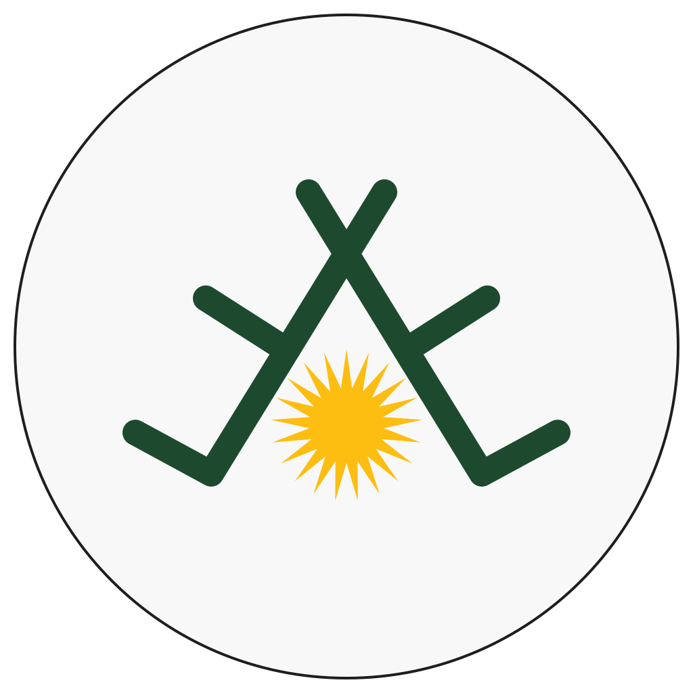
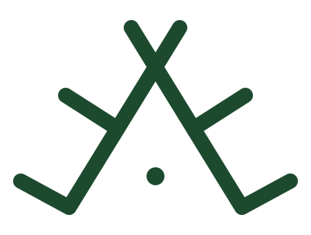
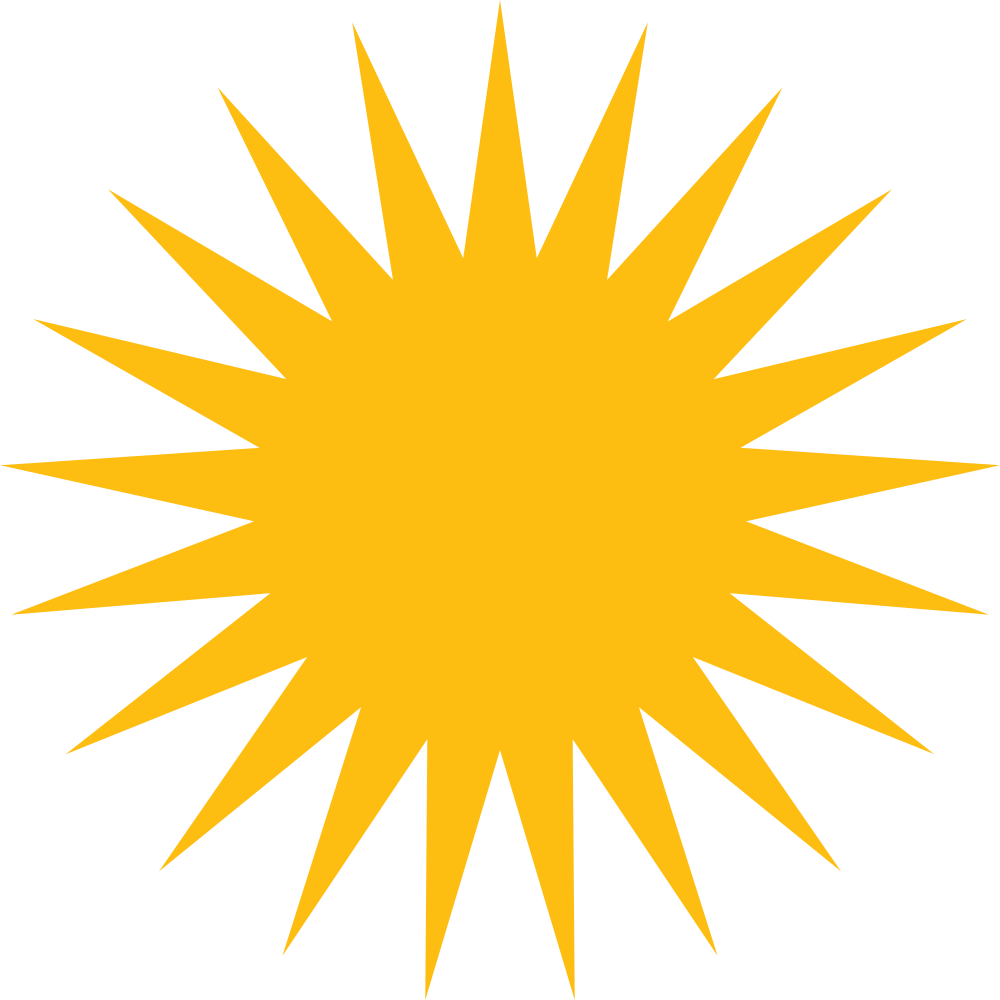

# The name and the logo

## Zimanyar: the language helper

**Zimanyar** (Sorani **زمانیار**) joins two Kurdish words: **ziman** (زمان), *language* and *tongue*, and **yar** (یار), *friend*, *companion*, *helper*. A zimanyar is a friend of the language: someone who walks beside a writer, points out what is wrong, explains why, and helps it come out right.

The name is the same in both varieties and both scripts, so Sorani and Kurmanji writers share one name for one tool.

## The logo

The logo joins two Kurdish signs: the **crown** of *deq*, the traditional Kurdish tattoo, and **Roj**, the sun of the flag of Kurdistan. The sun shines under the crown, where the sign has its dot: the Kurdish language, crowned.

  
  &nbsp;&nbsp;
  
  &nbsp;&nbsp;
  

### Deq

**Deq** (Kurdish *deq*, دەق; also *xał*, خاڵ; Syriac *daqqe*) is the traditional practice of permanent, hand-poked tattooing of Upper Mesopotamia. It is mainly practised among **Kurds and Yazidis**, and neighbouring Arab and Assyrian communities have shared similar customs. [1] The practice is older than Christianity, Yezidism and Islam.

Deq is more than decoration. Depending on the sign and where it is placed, it can stand for adornment, spiritual protection, healing or tribal belonging, and a woman's deq has been described as a diary of her life. The ink was made from soot, herbs and milk and pricked into the skin with a needle. The practice declined during the twentieth century, and today it is being revived as an expression of Kurdish identity. [1]

Every deq sign has a name and a meaning. Among the patterns recorded in Yazidi and Kurdish communities are the comb, the gazelle, the moon, the sun and the crown.

### The crown: تاج, taj

The crown is two long strokes that cross at the top, each ending in a foot, with a short branch on either side and a single dot underneath. In Sorani its meaning is given as **سەرکردایەتی و ڕاستگۆیی**: *leadership and truthfulness*.

Both fit a writing assistant. Truthfulness is what Zimanyar asks of every finding: it only says something is wrong when it can show the rule, the reason and the right form. And the crown's left foot, joined to its long stroke, is already a check mark, the sign for *correct*.

The logo keeps the shape of the sign, made symmetric, in the deep green of deq ink.

### Roj: the sun of the flag

The Kurdish Sun, *Roj* (ڕۆژ), "is a burning golden sun and the national emblem of the Kurds", found in the flag of Kurdistan. "The sun disk of the emblem contains 21 rays of equal size and shape"; the sun and the number 21 hold religious and cultural importance in Yazidism, Yarsanism and Alevism, and the 21 rays were chosen "to symbolize the rebirth of the Kurdish nation, identity, and dignity". [2] [3]

The logo uses the emblem itself, unchanged, in its own gold, in place of the crown's dot.

### A sibling of Roj

Zimanyar is a sibling of [Roj](https://github.com/0xdolan/roj), the Kurdish solar calendar, whose logo also joins a deq sign with the sun of the flag. Both logos share the white disc with a thin rim and the same flat, hand-drawn line.

### Colours

| Use | Colour |
| --- | --- |
| Sun | `#FEBD11` |
| Deq | `#1D4A2E` |
| Face | `#F8F8F8` |
| Rim | `#1E1E1E` |

The logo is drawn by [`scripts/brand/make-logo.mjs`](../scripts/brand/make-logo.mjs) from one geometry definition, so the SVG masters and every PNG size stay identical. See the [brand guide](../assets/brand/README.md) for the variants and the usage rules.

## Sources

Accessed on 28 October 2026.

1. *Deq (tattoo)*, Wikipedia. https://en.wikipedia.org/wiki/Deq_(tattoo)
2. *Kurdish Sun*, Wikipedia. https://en.wikipedia.org/wiki/Kurdish_Sun
3. *Flag of Kurdistan*, Wikipedia. https://en.wikipedia.org/wiki/Flag_of_Kurdistan

## Image credits

- Roj emblem: [Wikimedia Commons, File:Roj_emblem.svg](https://commons.wikimedia.org/wiki/File:Roj_emblem.svg), public domain.
- The crown sign and the Zimanyar logo: drawn for Zimanyar, GPL-3.0-or-later, like the rest of the project.
